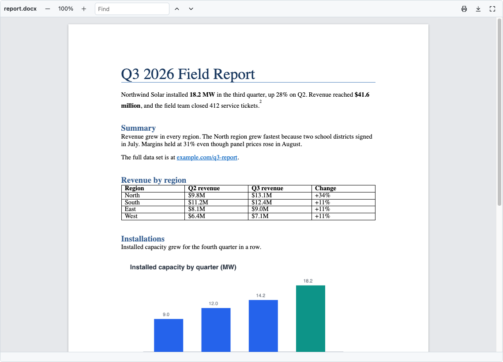

# Zovo Doc Viewer, to view DOCX, XLSX, CSV, Parquet, PDF and PPTX files in the browser

One web component that opens Word, Excel, CSV, Parquet, PDF and PowerPoint files inside your web page. The file is read by the browser. It is never uploaded to Google, Microsoft or anyone else, so private and intranet files work, and there is no 10 MB limit.

[Try the demo](https://theluckystrike.github.io/zovo-doc-viewer/) and drop any file on it.



```html
<script type="module" src="https://cdn.jsdelivr.net/gh/theluckystrike/zovo-doc-viewer@v0.1.0/dist/zovo-doc-viewer.js"></script>

<zovo-doc-viewer src="/files/report.docx" theme="auto" download="false"></zovo-doc-viewer>
```

## Formats

| Files | What you get | Engine |
|---|---|---|
| DOCX, DOCM, DOTX | Pages with headers, footers, footnotes, tables and pictures | docx-preview |
| ODT | Headings, lists, tables, links and pictures | built in |
| XLSX, XLSM, XLSB, XLS, ODS | Sheet tabs, a virtual-scroll grid, sort by column, find, copy a cell | SheetJS CE |
| CSV, TSV | Separator, header row and encoding found for you | built in |
| Parquet | The first 100,000 rows and a Schema tab; Snappy, Gzip, Zstd, Brotli, LZ4 | hyparquet |
| PDF | Pages drawn as you scroll, selectable text, find | pdf.js |
| PPTX, PPSX, POTX | Slides (beta, see [PPTX.md](PPTX.md)) | pptx-preview |

The format is found from the file's content first and its name second, so a PDF saved as `.docx` still opens as a PDF.

Every view has a toolbar with zoom, find, page or sheet navigation, print, download and full screen. Light, dark and auto themes follow the page or the system.

## Size

The element is about 10 KB gzipped. Each format has its own file, which loads only when a file of that type is opened:

| File | gzip |
|---|---|
| `zovo-doc-viewer.js` (the element) | 10 KB |
| `formats/csv.js` | 1.4 KB, plus a 3.5 KB shared grid |
| `formats/odt.js` | 2.6 KB, plus a 30 KB shared ZIP reader |
| `formats/docx.js` | 21 KB, plus the shared ZIP reader |
| `formats/sheet.js` | 122 KB |
| `formats/parquet.js` | 92 KB |
| `formats/pdf.js` | 122 KB, plus a 355 KB worker |
| `formats/pptx.js` | 393 KB |

Exact numbers for each release are in `dist/SIZES.json`.

## Install

### From the CDN

Use the `<script type="module">` tag above. A classic script is also built: `dist/zovo-doc-viewer.iife.js`, which sets `window.ZovoDocViewer`.

### Self-hosted

Copy the `dist/` folder to your site and load `dist/zovo-doc-viewer.js` from there. The format files are found next to it. If your bundler moves the element somewhere else, tell it where `dist/` is:

```js
import { setBaseUrl } from './zovo-doc-viewer/zovo-doc-viewer.js';
setBaseUrl('/static/zovo-doc-viewer/');
```

An npm package will follow.

## Attributes

| Attribute | Values | Default |
|---|---|---|
| `src` | URL of the file. Same-origin cookies are sent; add `crossorigin="use-credentials"` to send them to another origin. | none |
| `theme` | `light`, `dark` or `auto` | `auto` |
| `download` | `false` hides the download button | shown |
| `print` | `false` hides the print button and Ctrl+P inside the viewer | shown |
| `toolbar` | `false` hides the toolbar | shown |
| `filename` | Name used for detection and download when the URL has none | from `src` |
| `format` | Force a format: `docx`, `odt`, `xlsx`, `xls`, `ods`, `csv`, `tsv`, `parquet`, `pdf`, `pptx` | detected |
| `max-size` | Largest file in MB | `200` |
| `base-url` | Where the `formats/` folder is | next to the script |
| `license-key` | Your commercial licence key | none |

The height is 600 px. Change it with `--zdv-height` or a normal `height` on the element.

## JavaScript

```js
const viewer = document.querySelector('zovo-doc-viewer');

await viewer.load(file);                    // a File, Blob, ArrayBuffer, typed array or URL
await viewer.load(bytes, { name: 'q3.xlsx' });
viewer.goToPage(3);                         // or viewer.page = 3
viewer.zoom = 1.5;
const { count } = await viewer.find('revenue');
viewer.findNext(); viewer.findPrevious();
viewer.print(); viewer.download();
viewer.format; viewer.pageCount; viewer.licensed;

viewer.addEventListener('load', (e) => e.detail);   // { format, name, size, pages }
viewer.addEventListener('error', (e) => e.detail);  // { message, code }
viewer.addEventListener('page', (e) => e.detail);   // { page, pages }
```

Error codes: `network`, `http`, `too-large`, `empty`, `unsupported`, `zip-size`, `zip-entries`, `zip-corrupt`, `pdf`, `parquet`, `pptx-beta`, `module`.

Keyboard: Ctrl+F or Cmd+F finds inside the viewer, Enter and Shift+Enter step through matches, `+` `-` `0` zoom, `n` and `p` change page.

Examples for [plain HTML](examples/plain.html), [React](examples/react.jsx) and [Vue](examples/vue.vue) are in `examples/`.

## Styling

The colours are CSS variables. Set them on the element:

```css
zovo-doc-viewer {
  --zdv-accent: #7c3aed;
  --zdv-bg: #fff;
  --zdv-fg: #111;
  --zdv-line: #ddd;
  --zdv-head: #fafafa;
  --zdv-desk: #eee;          /* the area around pages */
  --zdv-height: 80vh;
}
zovo-doc-viewer::part(toolbar) { font-size: 14px; }
```

Parts: `viewer`, `toolbar`, `name`, `view`, `status`.

## Privacy and safety

- The element makes one request of its own: the `src` file. It also loads its own format files from where you host it. There is no analytics, no telemetry and no licence server.
- Office files are ZIP archives. An archive that would unpack to more than 500 MB or that holds more than 10,000 entries is refused before it is opened. The real unpacked size is counted too, so an archive that lies about its sizes is caught.
- CSV files stop at 1,000,000 rows or 20,000,000 cells, and spreadsheets at 200,000 rows a sheet. The viewer says when it shows only part of a file.
- Links inside documents open in a new tab, and only `http`, `https` and `mailto` links are kept. Scripts and macros in documents are never run.
- `download="false"` hides the button. It is not copy protection: anyone who can see a file in a browser can save it.

## Browsers

Current Chrome, Edge, Firefox and Safari 16.4 or newer.

## Licence

Zovo Doc Viewer is free under [GPL-3.0-or-later](LICENSE). For closed-source websites and apps there is a commercial licence:

- USD 79 once for 1 project: [buy with GitHub Sponsors](https://github.com/sponsors/theluckystrike/sponsorships?tier_id=680015)
- USD 199 once for unlimited projects: [buy with GitHub Sponsors](https://github.com/sponsors/theluckystrike/sponsorships?tier_id=680016)

On public pages without a key, a small "Zovo Doc Viewer" link shows in the corner of the viewer. A valid key removes it. On localhost the link never shows. Details and questions: [COMMERCIAL.md](COMMERCIAL.md). Bundled libraries and their licences: [THIRD-PARTY-NOTICES.md](THIRD-PARTY-NOTICES.md).

## Build

```sh
npm install
npm run build      # dist/ and dist/SIZES.json
npm test           # node --test, no browser needed
```

## Support Zovo

Zovo Doc Viewer is made by [theluckystrike](https://github.com/theluckystrike) on GitHub. If it saves you time, you can support the work on [GitHub Sponsors](https://github.com/sponsors/theluckystrike) or with [PayPal](https://www.paypal.com/paypalme/najzzz). A star on this repo also helps other people find it.

## More tools by Zovo

The same viewers inside VS Code, free:

- [DOCX Viewer & ODT Viewer](https://marketplace.visualstudio.com/items?itemName=zovo.docx-viewer-vscode). Previews Word and ODT files with dark mode, an outline and search.
- [XLSX Viewer & CSV Preview](https://marketplace.visualstudio.com/items?itemName=zovo.table-viewer-vscode). Opens CSV, TSV, Excel and Parquet files as a sortable, filterable table.
- [PDF Viewer & Reader](https://marketplace.visualstudio.com/items?itemName=zovo.pdf-viewer-dark). Reads PDFs with a real dark mode, search, an outline and thumbnails.
- [PPTX Viewer & PowerPoint Preview](https://marketplace.visualstudio.com/items?itemName=zovo.pptx-slide-viewer). Shows PowerPoint slides, thumbnails and speaker notes.
- [Hex Viewer & Binary Viewer](https://marketplace.visualstudio.com/items?itemName=zovo.zovo-hex-viewer). Opens files of any size in under a second.

## More from zovo

- [All free zovo VS Code extensions](https://marketplace.visualstudio.com/publishers/zovo) — file viewers, database clients, formatters. Offline, no telemetry, no sign-up.
- [Full MCP server catalogue](https://theluckystrike.github.io/mcp/) — local-first MCP servers for back-office work: invoices, VAT, PDFs, spreadsheets, payroll.
- [Hosted no-install MCP endpoints](https://mcp.zovo.one) — paste a URL in Claude / Cursor, nothing to install.
